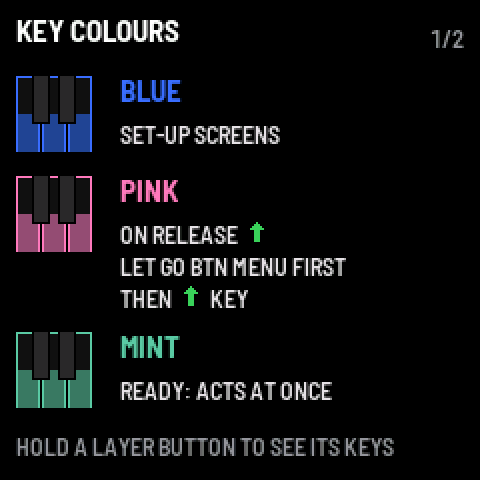
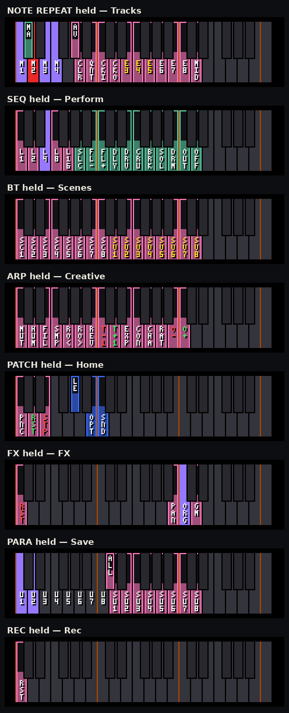
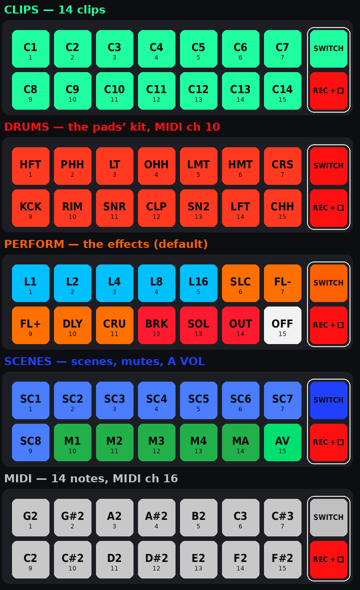

# OpenVALive SMK-37

<p align="center"></p>

**A live-first open-source firmware for the M-VAVE SMK-37 Elite and Pro.**

Four tracks with their own loops, CAPTURE (play freely, press once, it loops in time), LOOP EDIT, undo, scenes and
Morph, hold-to-play effects and a Creative Engine — on a virtual analog synth (60 sounds) and five drum kits — with
what the SMK-37 adds: 37 keys drawn on screen while a layer button is held, 16 pressure-sensitive RGB pads (CLIPS,
DRUMS with rolls by pressure, PERFORM, SCENES, MIDI), 4 faders, the wheels, a pedal, 8 knobs and a **MIDI OUT jack** that drives
a Roland T-8 (clock and notes). Built without M-VAVE's Bluetooth stack: room for the logo and more.

> 🇫🇷 **Français** — toute la documentation existe en français dans [`docs/_FR`](docs/_FR/), à commencer par
> [le SMK-37](docs/_FR/02-le-smk37.md) ; les repères d'un coup d'œil (clavier à l'écran, aide, menus) :
> [22 — Repères](docs/_FR/22-reperes-ecran-et-menus.md).

**Status:** runs on an SMK-37 Elite (first tests, November 2026); host-tested; the Pro builds but is untested.

## At a glance

<table><tr>
<td width="250"></td>
<td>

**Key colours** on the screen keyboard (hold a layer button to see it):

- **pink**: valid on release: let the menu button go first, then the key
- **violet**: on · **mint**: ready, acts at once · **yellow**: pressed
- **blue**: opens a set-up screen · **red**: a muted track

Each key shows its name (3 characters at most); a dark orange line marks each C. After the logo, two help pages
come in turn (OPTION CONTROL: HELP AT START).

</td></tr></table>

<p align="center"></p>

The 16 pads, mode by mode; framed on the right, **SWITCH** (MODE: the next mode) and **REC + ▢** (REC + a pad: keep):

<p align="center"></p>

Every layer, the buttons, the set-up menus, the pads and the sounds:
**[22 — At a glance](docs/_EN/22-screen-keyboard-and-menus.md)** · 🇫🇷 **[22 — Repères](docs/_FR/22-reperes-ecran-et-menus.md)**

## The OpenVALive family

| Repository | What | Licence |
|---|---|---|
| **OpenVALive_SMK-37** (this one) | the SMK-37 Elite / Pro firmware, on M-VAVE's [smk37_open](https://github.com/m-vave/smk37_open) | GPL-3.0 + linking exception |
| [OpenVALive_CORE](https://github.com/Tom-Rfid/OpenVALive_CORE) | the synth itself: DSP, engines, Live Core, the app — here in `va/` | MIT |
| [OpenVALive_FM-1](https://github.com/Tom-Rfid/OpenVALive_FM-1) | the same instrument on the FM-1 | MIT |

On [The Firmware Hub](https://thefirmwarehub.com): **FM-1_037** (this firmware) and **FM-1_023** (the FM-1's).

## Get started

| I want to... | Do this |
|---|---|
| **install it** | the latest [release](https://github.com/Tom-Rfid/OpenVALive_SMK-37/releases): `OpenVALive-SMK37-Elite-X.Y.Z.zip` (or Pro), then `FLASH-SMK37.bat` ([guide](docs/_EN/02-the-smk37.md)) |
| **try the latest build** | [preview-dev](https://github.com/Tom-Rfid/OpenVALive_SMK-37/releases/tag/preview-dev): `openvalive-smk37-elite-X.Y.Z.fwsc` (or pro) |
| **go back to M-VAVE's firmware** | the SMK37 OPEN web workbench: Restore factory V16 |
| **bring back a unit that no longer starts** | [jieli-usbkey-unbrick](https://github.com/Tom-Rfid/jieli-usbkey-unbrick) (also in `recovery/`): a Raspberry Pi through the USB cable, the unit stays closed |
| **build it** | `git clone --recursive`, then [02 — building it yourself](docs/_EN/02-the-smk37.md#building-it-yourself) |

## Repository map

```
targets/smk37/   the SMK-37 target: app.h, smk37_app.c (platform + extras), smk37_sdk.c (SDK hooks),
                 board/ (panel, audio), build.py (compile, link, package), tests/host_test.c, SMK37_OPEN_COMMIT
va/              OpenVALive CORE, a git submodule pinned to one version (sh scripts/va.sh status)
scripts/         va.sh / va.ps1 (the submodule), windows/ (FLASH-SMK37.bat, flash-smk37.ps1)
recovery/        jieli-usbkey-unbrick (submodule): bring back a unit that no longer starts
tests/           run_tests.sh: OpenVALive CORE's tests, then the SMK-37 host test
docs/            _EN (English) and _FR (français)
```

## Documentation

| | English | Français |
|---|---|---|
| Overview | [01](docs/_EN/01-overview.md) | [01](docs/_FR/01-presentation.md) |
| The SMK-37: install, controls, MAP CONTROL, T-8, test plan, building | [02](docs/_EN/02-the-smk37.md) | [02](docs/_FR/02-le-smk37.md) |
| The synth inside: how it is wired | [03](docs/_EN/03-the-synth-inside.md) | [03](docs/_FR/03-le-synthe-a-l-interieur.md) |
| Rules: code, git, publishing | [18](docs/_EN/18-rules-git-and-publishing.md) | [18](docs/_FR/18-regles-git-et-publication.md) |
| FM-1 ↔ SMK-37: the controls side by side | [21](docs/_EN/21-fm1-smk37-controls.md) | [21](docs/_FR/21-commandes-fm1-smk37.md) |
| **At a glance: screen keyboard, help, menus, pads** | [22](docs/_EN/22-screen-keyboard-and-menus.md) | [22](docs/_FR/22-reperes-ecran-et-menus.md) |

How the target is made: [targets/smk37/README.md](targets/smk37/README.md). State: [STATUS.md](STATUS.md) ·
[CLAUDE.md](CLAUDE.md) · [CONTRIBUTING.md](CONTRIBUTING.md) · [CHANGELOG.md](CHANGELOG.md).

## Licence and thanks

GPL-3.0-only with `smk37_open`'s linking exception ([COPYING.md](COPYING.md), [LICENSE](LICENSE)); `va/` is MIT,
fm1-base's files MPL-2.0. Built on M-VAVE's [smk37_open](https://github.com/m-vave/smk37_open) and Charles Vestal's
[fm1-base](https://github.com/charlesvestal/fm1-base). OpenVALive is not affiliated with or endorsed by M-VAVE.
