# 22 — At a glance: the screen keyboard, the help and the menus

Everything the SMK-37’s screen shows, at a glance: the key colours, the two help pages at start, each layer of the keyboard with its keys’ names, the buttons, the set-up menus, the pads and the sound families. The screens come from the firmware itself (the FM-1 simulator; the SMK-37 draws the same, with NOTE in place of SEL).

## Key colours

| Colour | Meaning |
|---|---|
| **pink** | valid on release: let the menu button go first, then the key |
| **violet** | on (a track playing, an effect running…) |
| **mint** | ready: acts at once |
| **mint / pink in turn** | valid on release and on |
| **yellow** | pressed |
| **blue** | opens a set-up screen |
| **red** | muted track (SEL) |

Each key shows its name (3 characters at most, written top to bottom); a dark orange line marks each C.

## Help at start

Two pages in turn every 3 s. Notes and SEL (NOTE on the SMK-37) leave them up; any other button or a knob closes them and does its job. A logo cut short skips them. OPTION CONTROL: HELP AT START.

 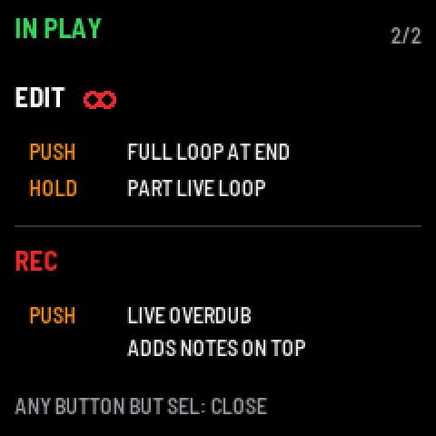

## The layers

Holding a layer button shows its keys. The SMK-37 has 37 keys from C: the functions are on the same white and black keys, counted from the left.

### Tracks — NOTE REPEAT held

The mutes act at once; the rest is valid on release (let NOTE REPEAT go first).

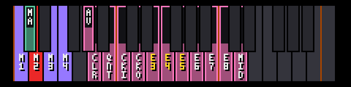

| Key | Function |
|---|---|
| **M1–M4** | Mute / unmute tracks 1 to 4 |
| **CLR** | CLEAR: the selected track wiped |
| **QNT** | QUANTIZE |
| **CKI** | CLOCK IN: follows the external MIDI clock |
| **CKO** | CLOCK OUT: sends the MIDI clock |
| **E3–E5** (yellow) | Euclid 3, 4, 5 hits |
| **E6–E8** | Euclid 6, 7, 8 hits |
| **MID** | FULL MIDI mode (controller) |
| **MA** | Black key 1: MUTE ALL, the four tracks |
| **AV** | Black key 4: A VOL, the levels brought together |

### Perform — SEQ held

Loops valid on release (OCT+ from L16: 1/32); the effects act at once. Held = while held, short tap = latched.

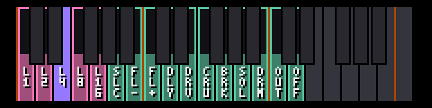

| Key | Function |
|---|---|
| **L1** | Loop 1 bar |
| **L2 L4 L8** | Loops 1/2, 1/4, 1/8 |
| **L16** | Loop 1/16 |
| **SLC** | SLICER: the mix cut in 1/16s |
| **FL-** | Filter shut |
| **FL+** | Filter open |
| **DLY** | Delay throw |
| **DRV** | Drive |
| **CRU** | Crush |
| **BRK** | Break: drums out |
| **SOL** | Solo the track |
| **DRM** | Drums only |
| **OUT** | All out |
| **OFF** | Every effect off |

### Scenes — BT held

Valid on release. Recalled on the next bar while playing.

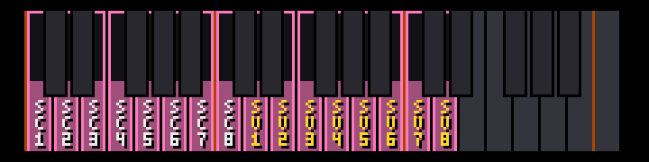

| Key | Function |
|---|---|
| **SC1–SC8** | Recall scene 1 to 8 |
| **SV1–SV8** (yellow) | Store scene 1 to 8 |

### Creative — ARP held

Valid on release (let ARP go first).

| Key | Function |
|---|---|
| **MUT** | Mutate |
| **HUM** | Humanize |
| **FIL** | Fill |
| **SMP** | Simplify |
| **RO< RO>** | Rotate left / right |
| **REV** | Reverse |
| **T-1** (red) | Transpose −1 |
| **T+1** (green) | Transpose +1 |
| **EXP** | Expand |
| **CON** | Contract |
| **CHA** | Chance |
| **RAT** | Ratchet |
| **O-** (red) | Octave − |
| **O+** (green) | Octave + |

### Home — PATCH held

Valid on release. The set-up screens are blue.

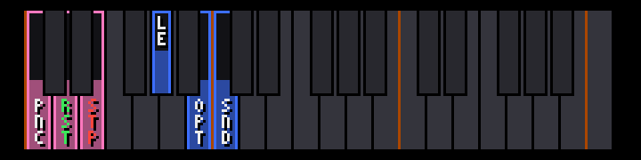

| Key | Function |
|---|---|
| **PNC** | PANIC: every note off |
| **RST** (green) | RESTART: from the top (sync) |
| **STP** (red) | STOP |
| **OPT** | White key 7: OPTION CONTROL |
| **SND** | White key 8: SOUNDS |
| **LE** | Black key 4: LOOP EDIT |

### FX — FX held

Valid on release.

| Key | Function |
|---|---|
| **RST** (red) | The line reset |
| **PAN** | White key 14: the wheel pans (SMK-37 only) |
| **ORG** | Drum keys ORIGINAL |
| **GM** | Drum keys GM |

### Save — PARA held

Valid on release. SAVE alone saves nothing; ALL blinks when something is to be saved.

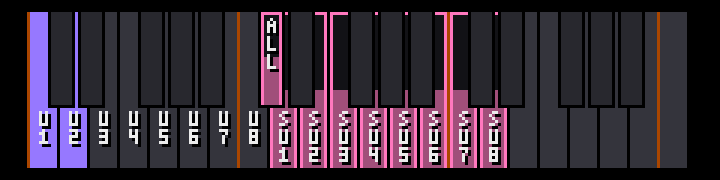

| Key | Function |
|---|---|
| **U1–U8** | Load USER sound 1 to 8 |
| **SU1–SU8** | Store the track’s sound as USER 1 to 8 |
| **ALL** | Black key 6 (between U8 and SU1): SAVE ALL, the whole live set |

### Rec — REC held

Valid on release.

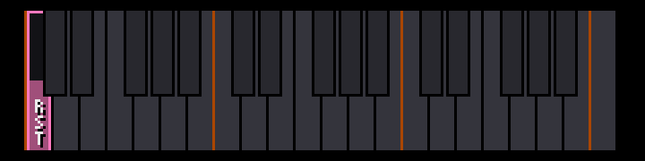

| Key | Function |
|---|---|
| **RST** | White key 1: RESET the track |

## The buttons

| FM-1 | SMK-37 | Alone | Held |
|---|---|---|---|
| **SEL** | **NOTE REPEAT** | takes a sound waiting | Tracks |
| **SEQ** | **SEQ** | lets the loop go | Perform |
| **ARP** | **ARP** | on A: arpeggio mode | Creative |
| **GLO** | **BT** | — | Scenes; GLO + SEL: MAP CONTROL |
| **HOME** | **PATCH** | panic | Home |
| **SAVE** | **PARA** | nothing | Save |
| **FX** | **FX** | next knob page | FX |
| **EDIT** | **GLOBE** | CAPTURE (ENV undoes it) | EDIT + note: punch |
| **ENV / LFO** | **SCALE / CHORD** | UNDO / REDO | — |
| **PLAY / REC** | **PLAY / REC** | transport / record | REC + white key 1: RESET the track |
| **OCT− / OCT+** | **OCT− / OCT+** | octave; family jump; loop ×2 / ÷2 | — |
| **—** | **KNOB BANK** | SHIFT | SHIFT + K1–K4: LIVE page; SHIFT + SELECT: SOUND EDIT |
| **—** | **FADER BANK** | faders: volumes → macros → USER | — |
| **—** | **< (Bluetooth)** | TAP tempo | held 0.5 s: MAP CONTROL |
| **—** | **> (PAD/STEP)** | next pad mode | — |

## The set-up menus

On each, HOME (PATCH on the SMK-37) or the MENU row at the bottom goes back to the play screen.

### OPTION CONTROL

**Open:** PATCH + white key 7

PLAY MODE (LIVE / FULL MIDI), DRUM KEYS, the D# / G# percussions, KEYS ON SCREEN, HELP AT START, the page a new sound brings on T1–T4 and A. SELECT picks the row, PRESET or ALGO changes the value, EDIT puts the default back.

 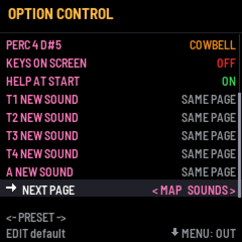

### SOUNDS

**Open:** PATCH + white key 8

The sounds PRESET offers, family by family (green: offered). SEL takes a sound out or back, OCT− / OCT+ the whole family. The top line names the chosen sound.

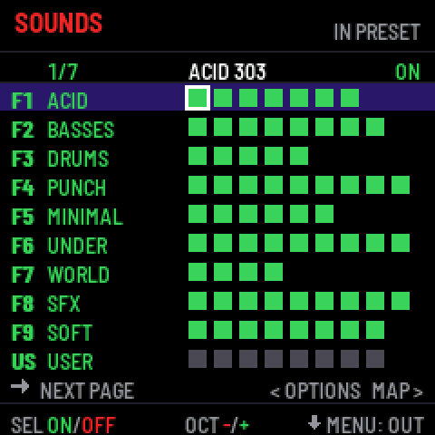 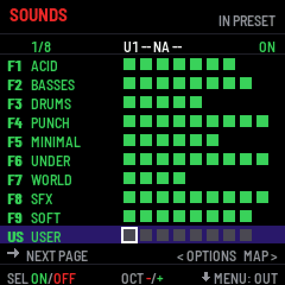

### LOOP EDIT

**Open:** PATCH + black key 4

The notes of the track's loop: POS, LEN, VEL, NOTE. REC deletes the note, EDIT adds one; EDIT + keys: a chord.

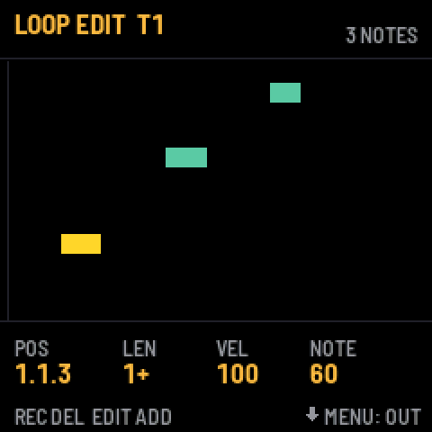

### MAP CONTROL

**Open:** BT + NOTE, or < held 0.5 s

The order of the knob pages in FX's turn (and which are in it), then what each knob of the LIVE, EQ and USER pages controls.

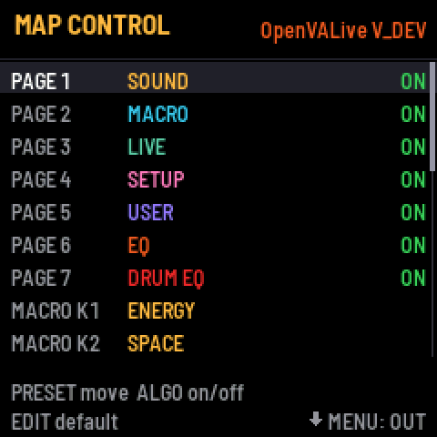 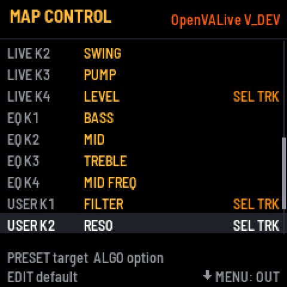

### SOUND EDIT

**Open:** SHIFT + SELECT

Every parameter of the line's sound: oscillators, filter, envelopes, then the modulation matrix. SELECT picks, PRESET changes, ALGO fine.

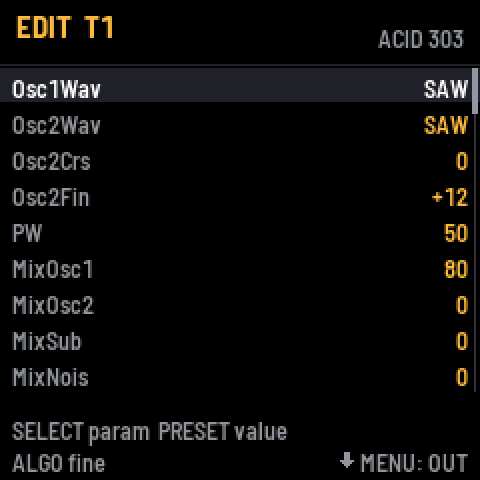  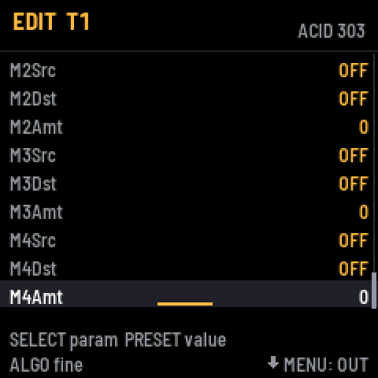

## The pads

16 pads: 14 to play, MODE top right (a tap: the next mode, the pad takes its colour), REC bottom right. The > button (PAD/STEP) also goes round the modes.

### CLIPS

14 clips: REC + pad arms one, the first note starts the take (4 bars at most). Tap = SINGLE, MODE + pad = LOOP latched. SHIFT + pad: delete. A clip's colour: red drums, green acid, pink USER, blue the others.

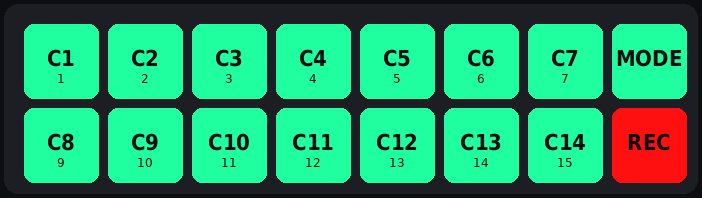

**C1** Clip 1, **C2** Clip 2, **C3** Clip 3, **C4** Clip 4, **C5** Clip 5, **C6** Clip 6, **C7** Clip 7, **C8** Clip 8, **C9** Clip 9, **C10** Clip 10, **C11** Clip 11, **C12** Clip 12, **C13** Clip 13, **C14** Clip 14.

### DRUMS

The pads' own drum kit, out on MIDI channel 10. REC held: the 5 kits on the first 5 pads. Pressure makes a roll: 1/8, 1/16, 1/32.

**Sol2** High floor tom, **Sol#2** Pedal hat, **La2** Low tom, **La#2** Open hat, **Si2** Low-mid tom, **Do3** Hi-mid tom, **Do#3** Crash, **Do2** Kick, **Do#2** Rimshot, **Ré2** Snare, **Ré#2** Clap, **Mi2** Snare 2, **Fa2** Low floor tom, **Fa#2** Closed hat.

### PERFORM

The default. SEQ's effects on the pads (DRIVE and DRUMS ONLY stay on the keys). Pressure on a held filter, delay or crush: 40 to 100 %.

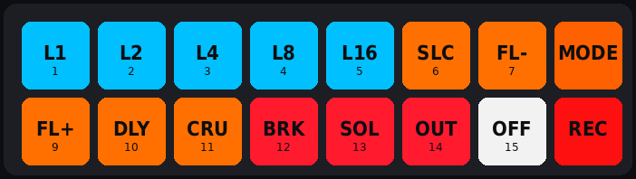

**L1** Loop 1 bar, **L2** Loop 1/2, **L4** Loop 1/4, **L8** Loop 1/8, **L16** Loop 1/16, **SLC** Slicer, **FL-** Filter shut, **FL+** Filter open, **DLY** Delay, **CRU** Crush, **BRK** Break, **SOL** Solo, **OUT** All out, **OFF** Every effect off.

### SCENES

Scenes 1–8 on the next bar (bright: the last one, pale: stored). Then the tracks' mutes, MUTE ALL and A VOL.

**SC1** Scene 1 (REC or SHIFT + pad: store it), **SC2** Scene 2 (REC or SHIFT + pad: store it), **SC3** Scene 3 (REC or SHIFT + pad: store it), **SC4** Scene 4 (REC or SHIFT + pad: store it), **SC5** Scene 5 (REC or SHIFT + pad: store it), **SC6** Scene 6 (REC or SHIFT + pad: store it), **SC7** Scene 7 (REC or SHIFT + pad: store it), **SC8** Scene 8 (REC or SHIFT + pad: store it), **M1** Mute track 1, **M2** Mute track 2, **M3** Mute track 3, **M4** Mute track 4, **MA** Mute all, **AV** A VOL.

### MIDI

14 notes from C2 on MIDI channel 16 only, no internal sound: for a drum machine or a sampler.

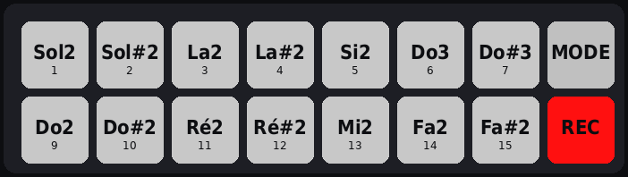

**Sol2** Note 43, channel 16, **Sol#2** Note 44, channel 16, **La2** Note 45, channel 16, **La#2** Note 46, channel 16, **Si2** Note 47, channel 16, **Do3** Note 48, channel 16, **Do#3** Note 49, channel 16, **Do2** Note 36, channel 16, **Do#2** Note 37, channel 16, **Ré2** Note 38, channel 16, **Ré#2** Note 39, channel 16, **Mi2** Note 40, channel 16, **Fa2** Note 41, channel 16, **Fa#2** Note 42, channel 16.

## The sounds

PRESET goes through them in this order, OCT− / OCT+ jump from one family to the next; each sound is described in [the FM-1’s doc 20](https://github.com/Tom-Rfid/OpenVALive_FM-1/blob/dev/docs/_EN/20-sounds-and-drum-keys.md).

| Family | Sounds |
|---|---|
| **F1 ACID** | 1 ACID 303, 2 ACID SQUARE, 3 ACID SCREAM, 4 SQUELCH, 5 SCREECH, 6 GRUNGE, 7 TALK |
| **F2 BASSES** | 8 BASS, 9 SUB, 10 DEEP SUB, 11 BOOM, 12 PSY BASS, 13 REESE, 14 WOBBLE, 15 ACID DEEP |
| **F3 DRUMS** | 16 DRUMS 808, 17 DRUMS 909, 18 DRUMS TIGHT, 19 DRUMS LOFI, 20 DRUMS IRON |
| **F4 PUNCH** | 21 LEAD, 22 GOA LEAD, 23 HOOVER, 24 ARP, 25 PLUCK, 26 STAB, 27 BRASS, 28 ORGAN, 29 VINTAGE KEYS |
| **F5 MINIMAL** | 30 RUBBER, 31 BLEEP, 32 CLICK, 33 DROPS, 34 BLIP, 35 METAL |
| **F6 UNDER** | 36 DUB CHORD, 37 DEEP STAB, 38 DEEP PAD, 39 RUMBLE, 40 DRONE, 41 HOLD, 42 PLATE, 43 CREAK, 44 WIND |
| **F7 WORLD** | 45 RAVE SAX, 46 LUTE, 47 FLUTE, 48 BAGPIPE |
| **F8 SFX** | 49 NOISE, 50 RISER, 51 DOWNLIFTER, 52 ZAP, 53 LASER, 54 SHAKER, 55 THUNDER, 56 RAIN, 57 DUB SIREN |
| **F9 SOFT** | 58 POLY, 59 PAD, 60 STRINGS, 61 STRINGS 70, 62 SWEEP, 63 WHALE, 64 CHOIR, 65 INIT |
| **US USER** | USER 1–8: your sounds, named after their origin ("U3 ACID 303", "U3 -- NA --" when it is unknown) |
