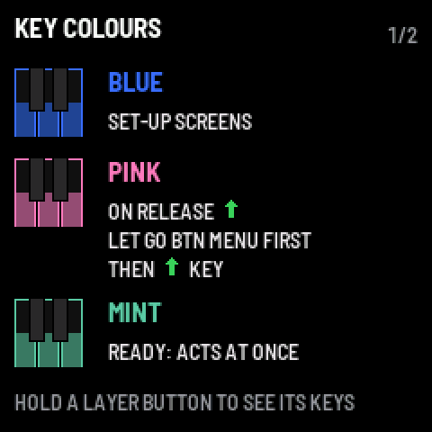
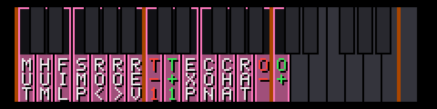
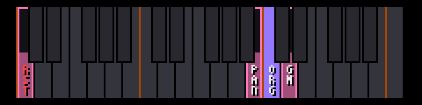
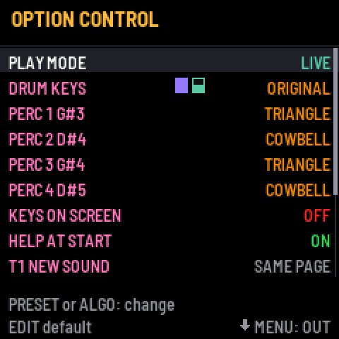
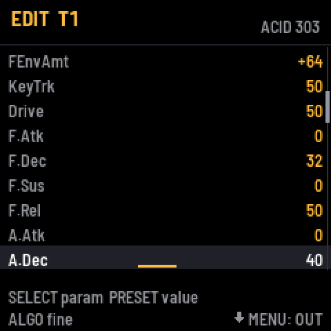
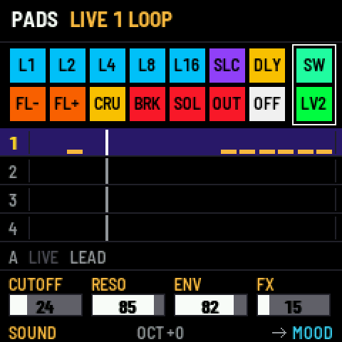
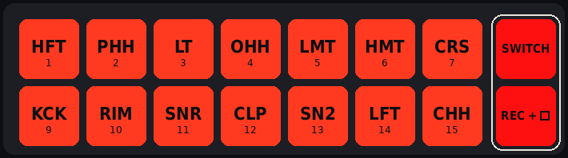
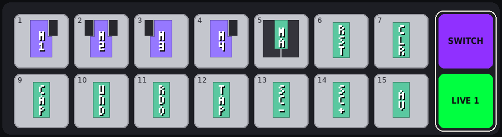
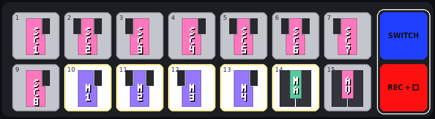

# 22 — At a glance: the screen keyboard, the help and the menus

Everything the SMK-37’s screen shows, at a glance: the key colours, the two help pages at start, each layer of the keyboard with its keys’ names, the buttons, the set-up menus, the pads and the sound families. The screens come from the firmware itself (the FM-1 simulator; the SMK-37 draws the same, with NOTE in place of SEL).

## Key colours

| Colour | Meaning |
|---|---|
| **pink** | valid on release: let the menu button go first, then the key |
| **violet** | on (a track playing, an effect running…) |
| **mint** | ready: acts at once |
| **mint / pink in turn** | valid on release and on |
| **yellow** | pressed |
| **blue** | opens a set-up screen |
| **red** | muted track (SEL) |

Each key shows its name (3 characters at most, written top to bottom); a dark orange line marks each C.

## Help at start

Two pages in turn every 3 s. Notes leave them up; SEL (NOTE on the SMK-37) turns them off for good; any other button or a knob closes them and does its job. A logo cut short skips them; after three rounds (18 s) they go by themselves. OPTION CONTROL: HELP AT START.

 

## The layers

Holding a layer button shows its keys. The SMK-37 has 37 keys from C: the functions are on the same white and black keys, counted from the left.

### Tracks — NOTE REPEAT held

The mutes act at once; the rest is valid on release (let NOTE REPEAT go first).

| Key | Function |
|---|---|
| **M1–M4** | Mute / unmute tracks 1 to 4 |
| **AV** | White key 6: A VOL, the levels brought together |
| **QNT** | QUANTIZE |
| **CKI** | CLOCK IN: follows the external MIDI clock |
| **CKO** | CLOCK OUT: sends the MIDI clock |
| **E3–E5** (yellow) | Euclid 3, 4, 5 hits |
| **E6–E8** | Euclid 6, 7, 8 hits |
| **MID** | FULL MIDI mode (controller) |
| **MA** | Black key 1: MUTE ALL, the four tracks |
| **LE** (blue) | Black key 3: LOOP EDIT, at once (violet) |
| **CLR** (red) | Black key 4: CLEAR TRACK, the selected track wiped |

### Perform — SEQ held

In groups: time (loops, slicer, delay), the filters, the sound (drive, crush), the cuts. Loops valid on release (OCT+ from L16: 1/32); the effects act at once. Held = while held, short tap = latched.

| Key | Function |
|---|---|
| **L1** | Loop 1 bar |
| **L2 L4 L8** | Loops 1/2, 1/4, 1/8 |
| **L16** | Loop 1/16 |
| **SLC** (violet) | SLICER: the selected track cut in 1/16s (on A: the whole mix); OCT− / OCT+ longer / shorter |
| **DLY** (yellow) | Delay throw |
| **FL-** (orange) | Filter shut |
| **FL+** (orange) | Filter open |
| **DRV** (yellow) | Drive |
| **CRU** (yellow) | Crush |
| **BRK** (red) | Break: drums out |
| **SOL** (red) | Solo the track |
| **DRM** (red) | Drums only |
| **OUT** (red) | All out |
| **OFF** | Every effect off |

### Scenes — BT held

Valid on release. Recalled on the next bar while playing.

| Key | Function |
|---|---|
| **SC1–SC8** | Recall scene 1 to 8 |
| **SV1–SV8** (yellow) | Store scene 1 to 8 |

### Creative — ARP held

Valid on release (let ARP go first).

| Key | Function |
|---|---|
| **MUT** | Mutate |
| **HUM** | Humanize |
| **FIL** | Fill |
| **SMP** | Simplify |
| **RO< RO>** | Rotate left / right |
| **REV** | Reverse |
| **T-1** (red) | Transpose −1 |
| **T+1** (green) | Transpose +1 |
| **EXP** | Expand |
| **CON** | Contract |
| **CHA** | Chance |
| **RAT** | Ratchet |
| **O-** (red) | Octave − |
| **O+** (green) | Octave + |

### Home — PATCH held

Valid on release. The set-up screens are blue.

| Key | Function |
|---|---|
| **PNC** | PANIC: every note off |
| **RST** (green) | RESTART: from the top (sync) |
| **STP** (red) | STOP |
| **OPT** | White key 7: OPTION CONTROL |
| **SND** | White key 8: SOUNDS |
| **LE** | Black key 4: LOOP EDIT |

### FX — FX held

Valid on release.

| Key | Function |
|---|---|
| **RST** (red) | The line reset |
| **ORG** | White key 6: drum keys ORIGINAL |
| **GM** | White key 7: drum keys GM |
| **PAN** | White key 14: the wheel pans (SMK-37 only) |

### Save — PARA held

Valid on release. SAVE alone saves nothing; ALL blinks when something is to be saved.

| Key | Function |
|---|---|
| **U1–U8** | Load USER sound 1 to 8 |
| **SU1–SU8** | Store the track’s sound as USER 1 to 8 |
| **ALL** | Black key 6 (between U8 and SU1): SAVE ALL, the whole live set |

### Rec — REC held

Valid on release.

| Key | Function |
|---|---|
| **RST** | White key 1: RESET the track |

## The buttons

| FM-1 | SMK-37 | Alone | Held |
|---|---|---|---|
| **SEL** | **NOTE REPEAT** | takes a sound waiting | Tracks |
| **SEQ** | **SEQ** | lets the loop go | Perform |
| **ARP** | **ARP** | on A: arpeggio mode | Creative |
| **GLO** | **BT** | — | Scenes; GLO + SEL: MAP CONTROL |
| **HOME** | **PATCH** | panic | Home |
| **SAVE** | **PARA** | nothing | Save |
| **FX** | **FX** | next knob page | FX |
| **EDIT** | **GLOBE** | CAPTURE (ENV undoes it) | EDIT + note: punch |
| **ENV / LFO** | **SCALE / CHORD** | UNDO / REDO | — |
| **PLAY / REC** | **PLAY / REC** | transport / record | REC + white key 1: RESET the track |
| **OCT− / OCT+** | **OCT− / OCT+** | octave; family jump; loop ×2 / ÷2 | — |
| **—** | **KNOB BANK** | SHIFT | SHIFT + K1–K4: LIVE page; SHIFT + SELECT: SOUND EDIT |
| **—** | **FADER BANK** | faders: volumes → macros → USER | — |
| **—** | **< (Bluetooth)** | TAP tempo | held 0.5 s: MAP CONTROL |
| **—** | **> (PAD/STEP)** | next pad mode | — |

## The set-up menus

On each, HOME (PATCH on the SMK-37) or the MENU row at the bottom goes back to the play screen.

### OPTION CONTROL

**Open:** PATCH + white key 7

PLAY MODE (LIVE / FULL MIDI), DRUM KEYS, the D# / G# percussions, KEYS ON SCREEN, HELP AT START, the page a new sound brings on T1–T4 and A. SELECT picks the row, PRESET or ALGO changes the value, EDIT puts the default back.

 

### SOUNDS

**Open:** PATCH + white key 8

The sounds PRESET offers, family by family (green: offered). SEL takes a sound out or back, OCT− / OCT+ the whole family. The top line names the chosen sound.

 

### LOOP EDIT

**Open:** PATCH + black key 4, or NOTE + black key 3

The notes of the track's loop: POS, LEN, VEL, NOTE. REC deletes the note, EDIT adds one; EDIT + keys: a chord.

### MAP CONTROL

**Open:** BT + NOTE, or < held 0.5 s

The order of the knob pages in FX's turn (and which are in it), then what each knob of the LIVE, EQ and USER pages controls.

 

### SOUND EDIT

**Open:** SHIFT + SELECT

Every parameter of the line's sound: oscillators, filter, envelopes, then the modulation matrix. SELECT picks, PRESET changes, ALGO fine.

  

## The pads

16 pads: 14 to play, and on the right (framed) MODE at the top, SWITCH: a tap = the next mode, the pad takes its colour, held a moment = the pads’ map on the screen; REC at the bottom: REC + a pad. The > button (PAD/STEP) also goes round the modes.

Three levels. 1 — every mode in full words, in the pads’ colours:

2 — in short, still in the pads’ colours:

3 — each pad with the key it stands for, as the screen keyboard draws it (same function, same colour: pink = valid on release on the keyboard, mint = acts at once, violet = a track playing; a black key between its two white keys in dark grey). The pad’s background shows that key’s light by default, layer held, playing, the four tracks playing: light grey off, a white band at the bottom offered, bright white on, white rays on grey blinking (DRUMS, a drum track: kicks and the open hat blink, snares and the closed hat lit):

MODE held alone a moment: the mode’s pads on the screen, in place of the scope:

### CLIPS

14 clips: REC + pad arms one at once, the first note starts the take (4 bars at most), the pad or REC ends it (it blinks every 1/4 s). Tap = SINGLE; the pad again = stop; pad held + REC = LOOP latched, in time. SHIFT + pad: delete. A clip's colour: red drums, green acid, pink USER, blue the others.

**C1** Clip 1, **C2** Clip 2, **C3** Clip 3, **C4** Clip 4, **C5** Clip 5, **C6** Clip 6, **C7** Clip 7, **C8** Clip 8, **C9** Clip 9, **C10** Clip 10, **C11** Clip 11, **C12** Clip 12, **C13** Clip 13, **C14** Clip 14.

### DRUMS

The pads' own drum kit, out on MIDI channel 10. REC held: the 5 kits on the first 5 pads, REC + pad takes one. Pressing harder makes a roll: 1/8, then 1/16, then 1/32, a step every 1/4 s.

**HFT** High floor tom (G2, note 43), **PHH** Pedal hat (G#2, note 44), **LT** Low tom (A2, note 45), **OHH** Open hat (A#2, note 46), **LMT** Low-mid tom (B2, note 47), **HMT** Hi-mid tom (C3, note 48), **CRS** Crash (C#3, note 49), **KCK** Kick (C2, note 36), **RIM** Rimshot (C#2, note 37), **SNR** Snare (D2, note 38), **CLP** Clap (D#2, note 39), **SN2** Snare 2 (E2, note 40), **LFT** Low floor tom (F2, note 41), **CHH** Closed hat (F#2, note 42).

### PERFORM

LIVE 1: the default, in mint (the live colour). SEQ's effects on the pads, by colour: on top the time ones (cyan loops blinking at their length, violet slicer, yellow delay), below the filters (orange), crush (yellow), the cuts (red) and OFF. DRIVE and DRUMS ONLY stay on the keys. Pressure on a held filter, delay or crush: 40 to 100 %. The bottom right pad (green) goes to LIVE 2.

**L1** Loop 1 bar, **L2** Loop 1/2, **L4** Loop 1/4, **L8** Loop 1/8, **L16** Loop 1/16, **SLC** Slicer, **DLY** Delay, **FL-** Filter shut, **FL+** Filter open, **CRU** Crush, **BRK** Break, **SOL** Solo, **OUT** All out, **OFF** Every effect off.

### LIVE 2

In violet, right after LIVE 1: what must start fast while playing. On top the mutes of tracks 1 to 4 (the same as SELECT + key), MUTE ALL, RESTART, CLEAR TRACK; below LOOP REC, UNDO, REDO, TAP tempo, previous / next stored scene, A VOL. The bottom right pad (green) goes back to LIVE 1.

**M1** Mute track 1, **M2** Mute track 2, **M3** Mute track 3, **M4** Mute track 4, **MA** Mute all, **RST** Restart: every track from its start, **CLR** Clear track: the selected track wiped, **CAP** Loop rec (as EDIT tapped), **UND** Undo, **RDO** Redo, **TAP** Tap tempo, **SC-** Previous stored scene, **SC+** Next stored scene, **AV** A VOL.

### SCENES

Scenes 1–8 on the next bar (bright: the last one, pale: stored). Then the tracks' mutes, MUTE ALL and A VOL.

**SC1** Scene 1 (REC or SHIFT + pad: store it), **SC2** Scene 2 (REC or SHIFT + pad: store it), **SC3** Scene 3 (REC or SHIFT + pad: store it), **SC4** Scene 4 (REC or SHIFT + pad: store it), **SC5** Scene 5 (REC or SHIFT + pad: store it), **SC6** Scene 6 (REC or SHIFT + pad: store it), **SC7** Scene 7 (REC or SHIFT + pad: store it), **SC8** Scene 8 (REC or SHIFT + pad: store it), **M1** Mute track 1, **M2** Mute track 2, **M3** Mute track 3, **M4** Mute track 4, **MA** Mute all, **AV** A VOL.

### MIDI

14 notes from C2 on MIDI channel 16 only, no internal sound: for a drum machine or a sampler.

**G2** Note 43, channel 16, **G#2** Note 44, channel 16, **A2** Note 45, channel 16, **A#2** Note 46, channel 16, **B2** Note 47, channel 16, **C3** Note 48, channel 16, **C#3** Note 49, channel 16, **C2** Note 36, channel 16, **C#2** Note 37, channel 16, **D2** Note 38, channel 16, **D#2** Note 39, channel 16, **E2** Note 40, channel 16, **F2** Note 41, channel 16, **F#2** Note 42, channel 16.

## The sounds

PRESET goes through them in this order, OCT− / OCT+ jump from one family to the next; each sound is described in [the FM-1’s doc 20](https://github.com/Tom-Rfid/OpenVALive_FM-1/blob/dev/docs/_EN/20-sounds-and-drum-keys.md).

| Family | Sounds |
|---|---|
| **F1 ACID** | 1 ACID 303, 2 SQUELCH, 3 ACID SQUARE, 4 ACID DEEP, 5 ACID SCREAM, 6 TALK |
| **F2 BASS** | 7 BASS, 8 SUB, 9 REESE, 10 PSY BASS, 11 DEEP SUB, 12 BOOM, 13 RUBBER, 14 WOBBLE |
| **F3 DRUMS** | 15 DRUMS 808, 16 DRUMS 909, 17 DRUMS TIGHT, 18 DRUMS LOFI, 19 DRUMS IRON |
| **F4 PERC** | 20 PLUCK, 21 BLEEP, 22 CLICK, 23 METAL, 24 PLATE, 25 BLIP, 26 DROPS |
| **F5 LEAD** | 27 LEAD, 28 GOA LEAD, 29 HOOVER, 30 ARP, 31 RAVE SAX, 32 BRASS, 33 BAGPIPE, 34 INIT |
| **F6 KEYS** | 35 STAB, 36 DEEP STAB, 37 DUB CHORD, 38 POLY, 39 ORGAN, 40 VINTAGE KEYS, 41 LUTE |
| **F7 SOFT** | 42 PAD, 43 STRINGS, 44 DEEP PAD, 45 STRINGS 70, 46 CHOIR, 47 SWEEP, 48 FLUTE, 49 WHALE |
| **F8 FX** | 50 RISER, 51 DOWNLIFTER, 52 NOISE, 53 ZAP, 54 LASER, 55 DUB SIREN, 56 SHAKER, 57 RAIN, 58 THUNDER |
| **F9 DARK** | 59 DRONE, 60 RUMBLE, 61 WIND, 62 HOLD, 63 CREAK, 64 GRUNGE, 65 SCREECH |
| **US USER** | USER 1–8: your sounds, named after their origin ("U3 ACID 303", "U3 -- NA --" when it is unknown) |
