# 22 — Repères : le clavier à l’écran, l’aide et les menus

Tout ce que montre l’écran du SMK-37, d’un coup d’œil : les couleurs des touches, les deux pages d’aide du démarrage, chaque couche du clavier avec le nom de ses touches, les boutons, les menus de réglage, les pads et les familles de sons. Les écrans viennent du firmware lui-même (simulateur du FM-1 ; le SMK-37 dessine les mêmes, avec NOTE à la place de SEL).

## Les couleurs des touches

| Couleur | Ce que ça veut dire |
|---|---|
| **rose** | validé au relâché : lâcher d’abord le bouton de menu, puis la touche |
| **violet** | actif (une piste qui joue, un effet en cours…) |
| **menthe** | disponible : agit tout de suite |
| **menthe / rose en alternance** | validé au relâché et actif |
| **jaune** | appuyée |
| **bleu** | ouvre un écran de réglage |
| **rouge** | piste coupée (SEL) |

Chaque touche porte son nom (3 caractères au plus, écrits de haut en bas) ; un trait orange foncé marque chaque do.

## L’aide au démarrage

Deux pages qui alternent toutes les 3 s. Les notes les laissent ; SEL (NOTE sur le SMK-37) les coupe pour de bon ; tout autre bouton ou un bouton rotatif les ferme et fait son travail. Un logo coupé avant la fin les saute ; après trois tours (18 s), elles s'en vont seules. Se règle dans OPTION CONTROL : HELP AT START.

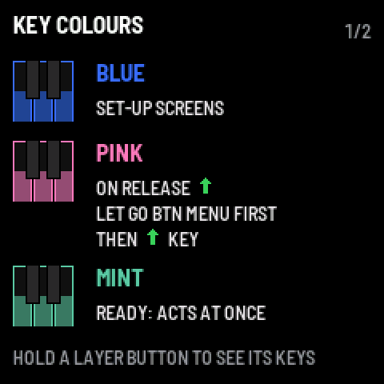 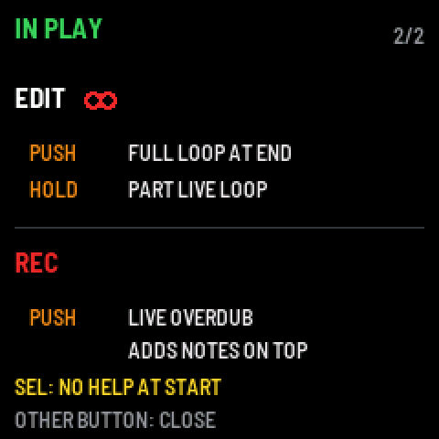

## Les couches

Tenir un bouton de couche montre ses touches. Le SMK-37 a 37 touches depuis Do : les fonctions sont sur les mêmes touches blanches et noires, comptées depuis la gauche.

### Pistes — NOTE REPEAT tenu

Les mutes agissent tout de suite ; le reste est validé au relâché (lâcher NOTE REPEAT en premier).

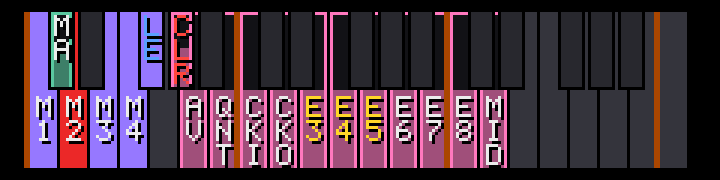

| Touche | Fonction |
|---|---|
| **M1–M4** | Mute / unmute des pistes 1 à 4 |
| **AV** | Blanche 6 : A VOL, les niveaux ramenés ensemble |
| **QNT** | QUANTIZE |
| **CKI** | CLOCK IN : suit l’horloge MIDI externe |
| **CKO** | CLOCK OUT : envoie l’horloge MIDI |
| **E3–E5** (jaune) | Euclide 3, 4, 5 coups |
| **E6–E8** | Euclide 6, 7, 8 coups |
| **MID** | Mode FULL MIDI (contrôleur) |
| **MA** | Noire 1 : MUTE ALL, les quatre pistes |
| **LE** (bleu) | Noire 3 : LOOP EDIT, tout de suite (violet) |
| **CLR** (rouge) | Noire 4 : CLEAR TRACK, efface la piste sélectionnée |

### Perform — SEQ tenu

Par groupes : le temps (boucles, slicer, delay), les filtres, le son (drive, crush), les coupures. Boucles validées au relâché (OCT+ depuis L16 : 1/32) ; les effets agissent tout de suite. Tenir = tant que tenu, tape courte = verrouillé.

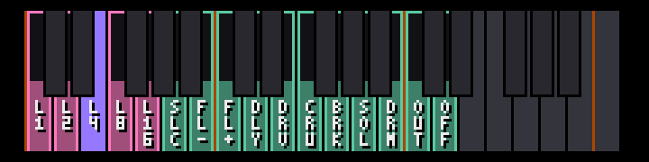

| Touche | Fonction |
|---|---|
| **L1** | Boucle 1 mesure |
| **L2 L4 L8** | Boucles 1/2, 1/4, 1/8 |
| **L16** | Boucle 1/16 |
| **SLC** (violet) | SLICER : la piste choisie coupée en 1/16 (sur A : tout le mix) ; OCT− / OCT+ plus long / plus court |
| **DLY** (jaune) | Delay throw |
| **FL-** (orange) | Filtre fermé |
| **FL+** (orange) | Filtre ouvert |
| **DRV** (jaune) | Drive |
| **CRU** (jaune) | Crush |
| **BRK** (rouge) | Break : batterie coupée |
| **SOL** (rouge) | Solo de la piste |
| **DRM** (rouge) | Drums only |
| **OUT** (rouge) | All out : tout coupé |
| **OFF** | Tous les effets arrêtés |

### Scènes — BT tenu

Validé au relâché. Rappel à la mesure suivante en lecture.

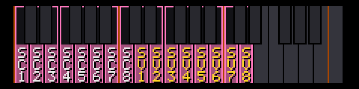

| Touche | Fonction |
|---|---|
| **SC1–SC8** | Rappeler la scène 1 à 8 |
| **SV1–SV8** (jaune) | Mémoriser la scène 1 à 8 |

### Creative — ARP tenu

Validé au relâché (lâcher ARP en premier).

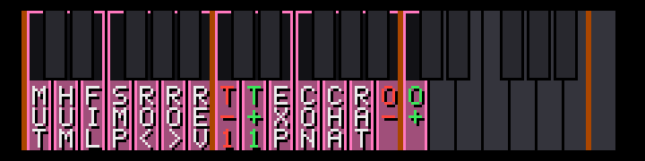

| Touche | Fonction |
|---|---|
| **MUT** | Mutate |
| **HUM** | Humanize |
| **FIL** | Fill |
| **SMP** | Simplify |
| **RO< RO>** | Rotate à gauche / à droite |
| **REV** | Reverse |
| **T-1** (rouge) | Transposer −1 |
| **T+1** (vert) | Transposer +1 |
| **EXP** | Expand |
| **CON** | Contract |
| **CHA** | Chance |
| **RAT** | Ratchet |
| **O-** (rouge) | Octave − |
| **O+** (vert) | Octave + |

### Home — PATCH tenu

Validé au relâché. Les écrans de réglage sont en bleu.

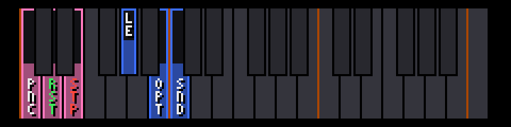

| Touche | Fonction |
|---|---|
| **PNC** | PANIC : toutes les notes coupées |
| **RST** (vert) | RESTART : repart du début (sync) |
| **STP** (rouge) | STOP |
| **OPT** | Blanche 7 : OPTION CONTROL |
| **SND** | Blanche 8 : SOUNDS |
| **LE** | Noire 4 : LOOP EDIT |

### FX — FX tenu

Validé au relâché.

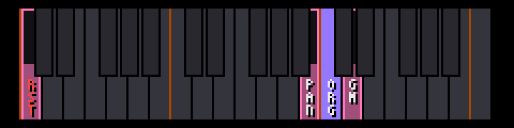

| Touche | Fonction |
|---|---|
| **RST** (rouge) | Remise à zéro de la ligne |
| **ORG** | Blanche 6 : carte batterie ORIGINAL |
| **GM** | Blanche 7 : carte batterie GM |
| **PAN** | Blanche 14 : la molette fait le pan (SMK-37 seulement) |

### Save — PARA tenu

Validé au relâché. SAVE seul ne sauve rien ; ALL clignote quand il y a quelque chose à sauver.

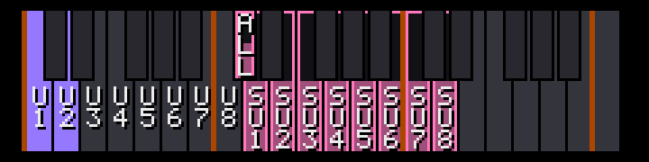

| Touche | Fonction |
|---|---|
| **U1–U8** | Charger le son USER 1 à 8 |
| **SU1–SU8** | Sauver le son de la piste en USER 1 à 8 |
| **ALL** | Noire 6 (entre U8 et SU1) : SAVE ALL, tout le live set |

### Rec — REC tenu

Validé au relâché.

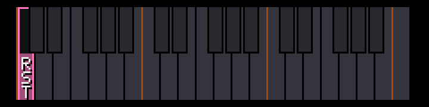

| Touche | Fonction |
|---|---|
| **RST** | Blanche 1 : RESET de la piste |

## Les boutons

| FM-1 | SMK-37 | Seul | Tenu |
|---|---|---|---|
| **SEL** | **NOTE REPEAT** | prend un son en attente | Pistes |
| **SEQ** | **SEQ** | relâche la boucle | Perform |
| **ARP** | **ARP** | sur A : mode d’arpège | Creative |
| **GLO** | **BT** | — | Scènes ; GLO + SEL : MAP CONTROL |
| **HOME** | **PATCH** | panic | Home |
| **SAVE** | **PARA** | rien | Save |
| **FX** | **FX** | page de boutons suivante | FX |
| **EDIT** | **GLOBE** | CAPTURE (ENV l’annule) | EDIT + note : punch |
| **ENV / LFO** | **SCALE / CHORD** | UNDO / REDO | — |
| **PLAY / REC** | **PLAY / REC** | transport / enregistrement | REC + blanche 1 : RESET de la piste |
| **OCT− / OCT+** | **OCT− / OCT+** | octave ; saut de famille ; boucle ×2 / ÷2 | — |
| **—** | **KNOB BANK** | SHIFT | SHIFT + K1–K4 : page LIVE ; SHIFT + SELECT : SOUND EDIT |
| **—** | **FADER BANK** | faders : volumes → macros → USER | — |
| **—** | **< (Bluetooth)** | TAP tempo | tenu 0,5 s : MAP CONTROL |
| **—** | **> (PAD/STEP)** | mode des pads suivant | — |

## Les menus de réglage

Sur chacun, HOME (PATCH sur le SMK-37) ou la ligne MENU en bas ramène à l’écran de jeu.

### OPTION CONTROL

**Ouvrir :** PATCH + blanche 7

PLAY MODE (LIVE / FULL MIDI), DRUM KEYS, les percussions des ré# / sol#, KEYS ON SCREEN, HELP AT START, la page qu’amène un nouveau son sur T1–T4 et A. SELECT choisit la ligne, PRESET ou ALGO change la valeur, EDIT remet la valeur par défaut.

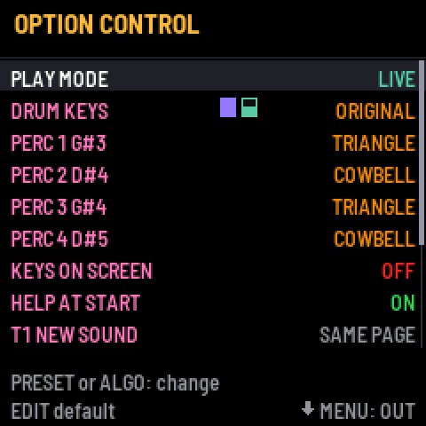 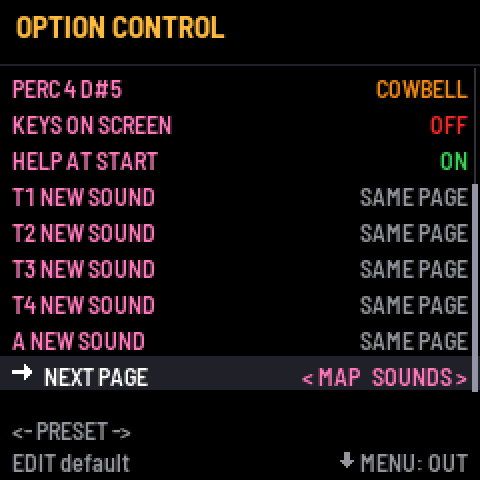

### SOUNDS

**Ouvrir :** PATCH + blanche 8

Les sons que PRESET propose, famille par famille (vert : proposé). SEL coupe ou remet un son, OCT− / OCT+ toute la famille. La ligne du haut donne le nom du son choisi.

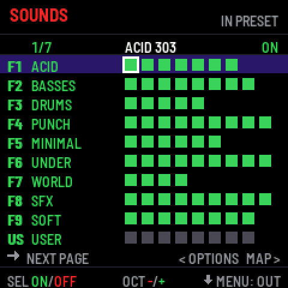 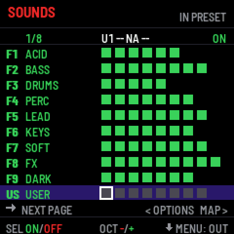

### LOOP EDIT

**Ouvrir :** PATCH + 4e noire, ou NOTE + 3e noire

Les notes de la boucle de la piste : POS, LEN, VEL, NOTE. REC efface la note, EDIT en ajoute une ; EDIT + touches : un accord.

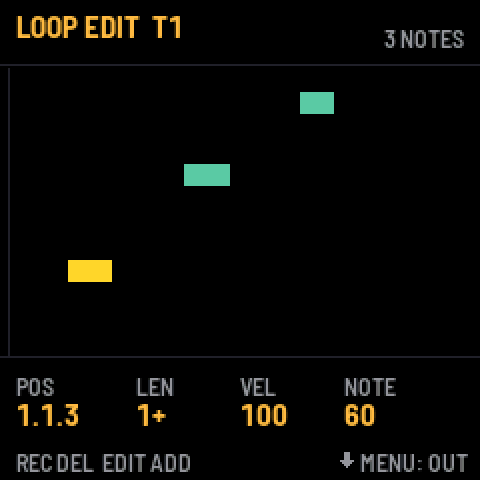

### MAP CONTROL

**Ouvrir :** BT + NOTE, ou < tenu 0,5 s

L’ordre des pages de boutons dans le tour de FX (et lesquelles en font partie), puis ce que commande chaque bouton rotatif des pages LIVE, EQ et USER.

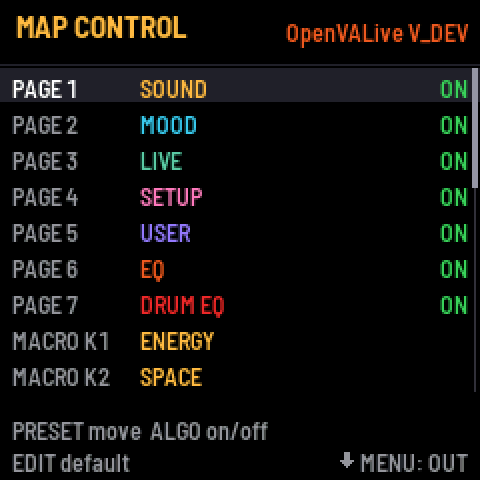 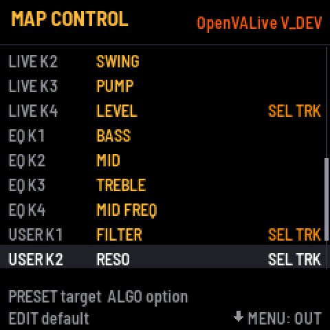

### SOUND EDIT

**Ouvrir :** SHIFT + SELECT

Tous les paramètres du son de la ligne : oscillateurs, filtre, enveloppes, puis la matrice de modulation. SELECT choisit, PRESET change, ALGO règle finement.

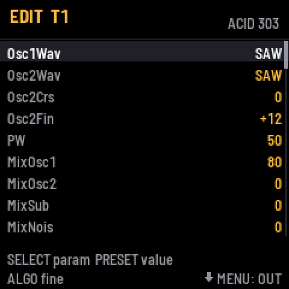 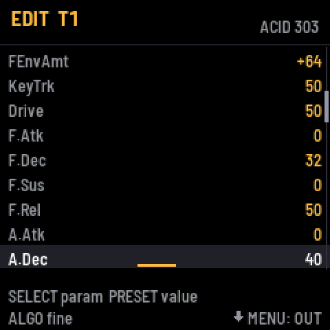 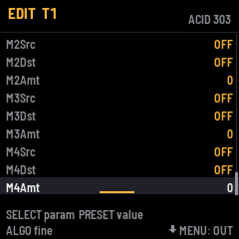

## Les pads

16 pads : 14 de jeu, et à droite (encadrés) MODE en haut, SWITCH : une tape = le mode suivant, le pad prend sa couleur, tenu un instant = la carte des pads à l’écran ; REC en bas : REC + un pad. Le bouton > (PAD/STEP) fait aussi le tour des modes.

Trois niveaux de lecture. 1 — tous les modes en toutes lettres, dans les couleurs des pads :

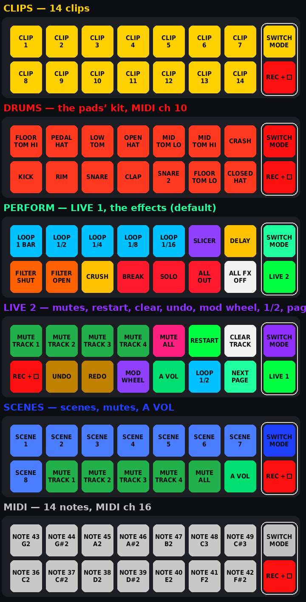

2 — en abrégé, toujours dans les couleurs des pads :

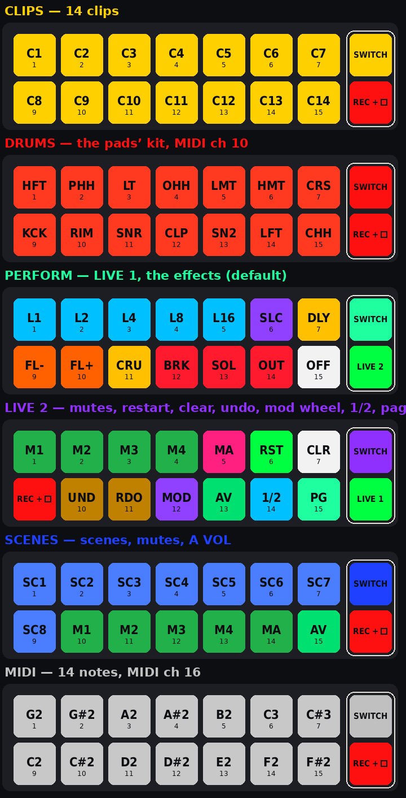

3 — chaque pad avec la touche qu’il remplace, comme le clavier à l’écran la dessine (même fonction, même couleur : rose = validé au relâché sur le clavier, menthe = agit tout de suite, violet = piste qui joue ; une touche noire entre ses deux blanches gris foncé). Le fond du pad montre la lumière de cette touche par défaut, couche tenue, en lecture, les quatre pistes qui jouent : gris clair éteinte, bandeau blanc en bas proposée, blanc vif allumée, rayons blancs sur gris clignotante (en DRUMS, une piste de batterie : grosses caisses et charley ouvert clignotent, caisses claires et charley fermé allumés) :

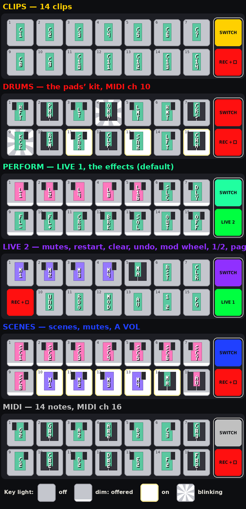

MODE tenu seul un instant : la carte des pads du mode à l’écran, à la place de l’oscilloscope :

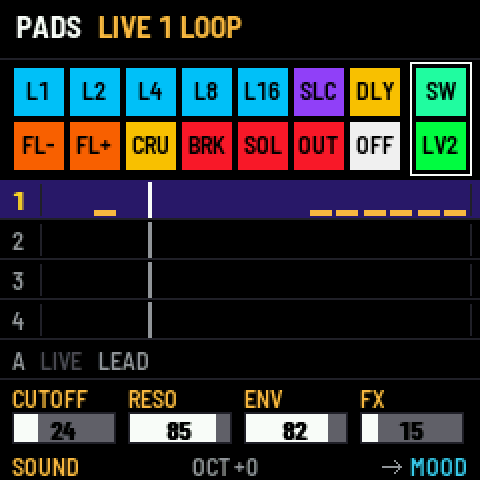

### CLIPS

14 clips : REC + pad l’arme tout de suite, la première note lance la prise (4 mesures au plus), le pad ou REC la termine (clignote 1/4 s). Tape = SINGLE ; le pad encore = stop ; pad tenu + REC = LOOP verrouillé, en mesure. SHIFT + pad : effacer. Couleur du clip : rouge batterie, vert acid, rose USER, bleu les autres.

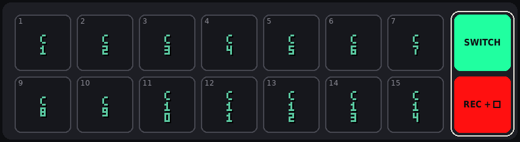

**C1** Clip 1, **C2** Clip 2, **C3** Clip 3, **C4** Clip 4, **C5** Clip 5, **C6** Clip 6, **C7** Clip 7, **C8** Clip 8, **C9** Clip 9, **C10** Clip 10, **C11** Clip 11, **C12** Clip 12, **C13** Clip 13, **C14** Clip 14.

### DRUMS

Le kit propre aux pads, sortie canal MIDI 10. REC tenu : les 5 kits sur les 5 premiers pads, REC + pad le prend. Appuyer plus fort fait un roulement : 1/8, puis 1/16, puis 1/32, un cran tous les 1/4 s.

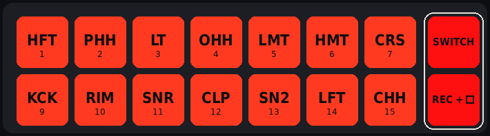

**HFT** Tom grave (G2, note 43), **PHH** Charley pédale (G#2, note 44), **LT** Tom moyen (A2, note 45), **OHH** Charley ouvert (A#2, note 46), **LMT** Tom médium (B2, note 47), **HMT** Tom aigu (C3, note 48), **CRS** Crash (C#3, note 49), **KCK** Grosse caisse (C2, note 36), **RIM** Rimshot (C#2, note 37), **SNR** Caisse claire (D2, note 38), **CLP** Clap (D#2, note 39), **SN2** Caisse claire 2 (E2, note 40), **LFT** Tom basse (F2, note 41), **CHH** Charley fermé (F#2, note 42).

### PERFORM

LIVE 1 : mode par défaut, en menthe (la couleur du live). Les effets de SEQ sur les pads, par couleur : en haut le temps (boucles cyan qui clignotent à leur longueur, slicer violet, delay jaune), en bas les filtres (orange), le crush (jaune), les coupures (rouge) et OFF. DRIVE et DRUMS ONLY restent sur les touches. Pression sur un filtre, delay ou crush tenu : 40 à 100 %. Le pad en bas à droite (vert) passe à LIVE 2.

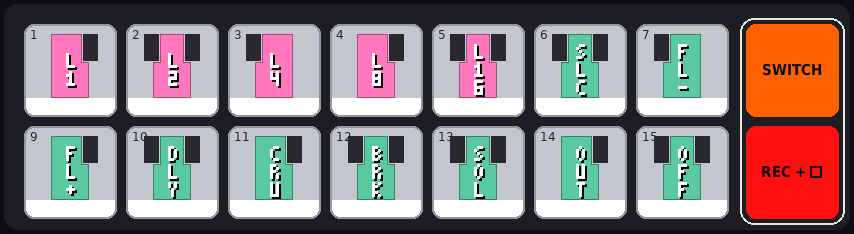

**L1** Boucle 1 mesure, **L2** Boucle 1/2, **L4** Boucle 1/4, **L8** Boucle 1/8, **L16** Boucle 1/16, **SLC** Slicer, **DLY** Delay, **FL-** Filtre fermé, **FL+** Filtre ouvert, **CRU** Crush, **BRK** Break, **SOL** Solo, **OUT** All out, **OFF** Tous les effets arrêtés.

### LIVE 2

LIVE 2 MUTE, en violet, juste après LIVE 1 : ce qu'il faut lancer vite en jouant. En haut les mutes des pistes 1 à 4 (les mêmes que SELECT + touche), MUTE ALL, RESTART, CLEAR TRACK ; en bas LOOP REC, UNDO, REDO, MOD (ce que fait la molette mod), A VOL, 1/2 (boucle deux fois plus courte), PAGE (page de boutons suivante). Le pad en bas à droite (vert) revient à LIVE 1. À chaque changement de mode, la carte des pads reste 4 s à l'écran (ou jusqu'à une touche).

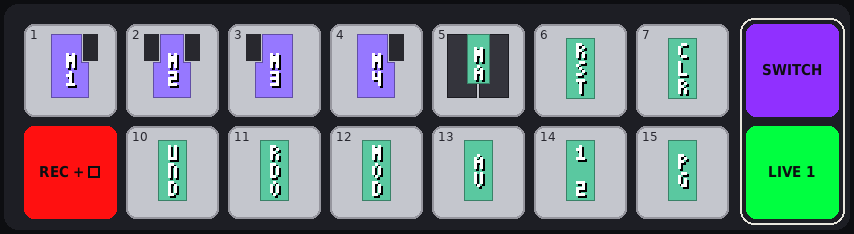

**M1** Mute piste 1, **M2** Mute piste 2, **M3** Mute piste 3, **M4** Mute piste 4, **MA** Mute all, **RST** Restart : toutes les pistes au début, **CLR** Clear track : efface la piste choisie, **UND** Undo, **RDO** Redo, **MOD** Ce que fait la molette mod, à tour de rôle : MORPH, FILTER, DELAY, CRUSH, DRIVE, PAN (sa couleur), **AV** A VOL, **1/2** La boucle de la piste deux fois plus courte (ENV annule), **PG** Page de boutons suivante, comme FX tapé (sa couleur).

### SCÈNES

Scènes 1–8 à la mesure suivante (vif : la dernière, pâle : enregistrée). Puis les mutes des pistes, MUTE ALL et A VOL.

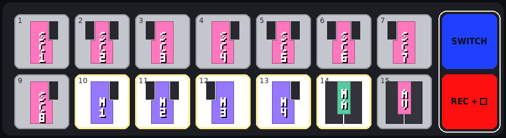

**SC1** Scène 1 (REC ou SHIFT + pad : la sauver), **SC2** Scène 2 (REC ou SHIFT + pad : la sauver), **SC3** Scène 3 (REC ou SHIFT + pad : la sauver), **SC4** Scène 4 (REC ou SHIFT + pad : la sauver), **SC5** Scène 5 (REC ou SHIFT + pad : la sauver), **SC6** Scène 6 (REC ou SHIFT + pad : la sauver), **SC7** Scène 7 (REC ou SHIFT + pad : la sauver), **SC8** Scène 8 (REC ou SHIFT + pad : la sauver), **M1** Mute piste 1, **M2** Mute piste 2, **M3** Mute piste 3, **M4** Mute piste 4, **MA** Mute all, **AV** A VOL.

### MIDI

14 notes depuis Do2 sur le canal MIDI 16 seulement, sans son interne : pour une boîte à rythmes ou un sampler.

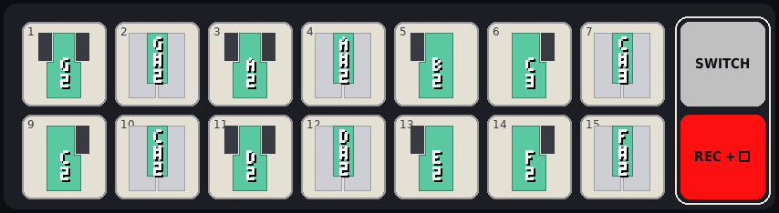

**G2** Note 43, canal 16, **G#2** Note 44, canal 16, **A2** Note 45, canal 16, **A#2** Note 46, canal 16, **B2** Note 47, canal 16, **C3** Note 48, canal 16, **C#3** Note 49, canal 16, **C2** Note 36, canal 16, **C#2** Note 37, canal 16, **D2** Note 38, canal 16, **D#2** Note 39, canal 16, **E2** Note 40, canal 16, **F2** Note 41, canal 16, **F#2** Note 42, canal 16.

## Les sons

PRESET les fait défiler dans cet ordre, OCT− / OCT+ sautent d’une famille à l’autre ; chaque son est décrit dans [le doc 20 du FM-1](https://github.com/Tom-Rfid/OpenVALive_FM-1/blob/dev/docs/_FR/20-sons-et-touches-batterie.md).

| Famille | Sons |
|---|---|
| **F1 ACID** | 1 ACID 303, 2 SQUELCH, 3 ACID SQUARE, 4 ACID DEEP, 5 ACID SCREAM, 6 TALK |
| **F2 BASS** | 7 BASS, 8 SUB, 9 REESE, 10 PSY BASS, 11 DEEP SUB, 12 BOOM, 13 RUBBER, 14 WOBBLE |
| **F3 DRUMS** | 15 DRUMS 808, 16 DRUMS 909, 17 DRUMS TIGHT, 18 DRUMS LOFI, 19 DRUMS IRON |
| **F4 PERC** | 20 PLUCK, 21 BLEEP, 22 CLICK, 23 METAL, 24 PLATE, 25 BLIP, 26 DROPS |
| **F5 LEAD** | 27 LEAD, 28 GOA LEAD, 29 HOOVER, 30 ARP, 31 RAVE SAX, 32 BRASS, 33 BAGPIPE, 34 INIT |
| **F6 KEYS** | 35 STAB, 36 DEEP STAB, 37 DUB CHORD, 38 POLY, 39 ORGAN, 40 VINTAGE KEYS, 41 LUTE |
| **F7 SOFT** | 42 PAD, 43 STRINGS, 44 DEEP PAD, 45 STRINGS 70, 46 CHOIR, 47 SWEEP, 48 FLUTE, 49 WHALE |
| **F8 FX** | 50 RISER, 51 DOWNLIFTER, 52 NOISE, 53 ZAP, 54 LASER, 55 DUB SIREN, 56 SHAKER, 57 RAIN, 58 THUNDER |
| **F9 DARK** | 59 DRONE, 60 RUMBLE, 61 WIND, 62 HOLD, 63 CREAK, 64 GRUNGE, 65 SCREECH |
| **US USER** | USER 1–8 : tes sons, nommés d’après leur origine (« U3 ACID 303 », « U3 -- NA -- » si elle est inconnue) |
